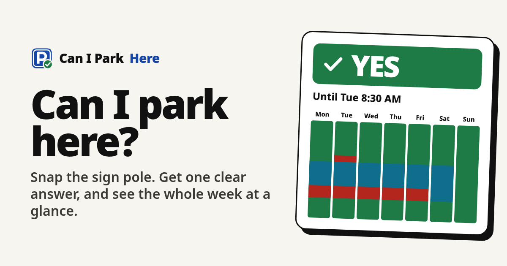

# Can I Park Here?

Snap a parking sign pole. Get one clear answer for right now, and see the whole week at a glance.

**Live:** https://park.trylumegrid.com



## What it is

A pole with four stacked parking signs turns parking into mental math. Can I Park Here reads the signs from a photo and gives one answer:

- A giant **YES**, **NO**, or **NOT SURE** for the time you pick and how long you are staying (15 min, 1 h, 2 h, 4 h, or overnight).
- The signs it read, as plain cards top to bottom. Switch off any card that looks wrong, or tap a card's arrow to fix its direction, and the answer updates.
- A week grid, Monday to Sunday, colored free, time limit or meter, not allowed, or not sure. Drag the time travel line to any moment of the week and the answer changes live. Tap a block to see which sign caused it.
- If a sign has an arrow, it asks which side of the pole your car is on.
- Answers are for a regular passenger car. Rules only for oversized vehicles, trucks, RVs, or buses stay on their card but don't limit you.
- Printed season dates (street cleaning APRIL 1 - OCT 31) are applied on the real calendar dates of the week shown.
- Share a sample pole with a link: `/?sample=p63` opens it straight to the check step.

It is a reading aid. Always double-check the sign. Photos are not stored.

## How it works

**The AI reads the signs; a plain, testable rules engine decides.** The AI never decides YES by itself.

1. The phone shrinks the photo and sends it to a Cloudflare Worker, which asks a Workers AI vision model (Llama 4 Scout, with Mistral Small 3.1 as a fallback) to copy each sign and turn it into structured rules, as strict JSON.
2. A validator checks every field. Anything malformed, unclear, or conditional (snow, game nights, sunrise to sunset) becomes a Not sure sign instead of being dropped or trusted. A season must match the dates printed on the sign, and "large vehicles only" is trusted only when the sign text names big vehicles. A sign cut off by the photo edge is meant to come back as unreadable, which makes the answer Not sure.
3. The rules engine turns the signs into 672 quarter-hour blocks for the week and checks every block of your stay. A clear not-allowed rule wins (NO). Anything uncertain beats an allowed rule (NOT SURE). Only a stay that is clearly allowed from start to end gets YES.
4. Arrows are easy to misread, so a sign whose arrow points away from your side shows as Not sure until you check it. Tap the arrow on its card to set it to left, right, both ways, or none; once you have set it, the engine trusts your answer. It is never silently ignored.
5. A sign that only says when parking is allowed ("public parking evenings and weekends") is Not sure at every other time.

The engine and the plain-language text are shared by the Worker and the browser (`public/js/engine/`), which is why dragging through the week needs no server trip. The three sample poles (Los Angeles County, San Francisco, Chicago) use saved real readings, so they load instantly and cost no AI quota.

### How accurate is it?

Tested on 26 real sign photos from Wikimedia Commons, each checked at 4 fixed times (Mon 9:00 AM, Tue 8:45 AM, Sat 2:00 PM, Sun 3:00 AM in the week of Oct 19, 2026) with a 60 minute stay, 104 answers in all, run 2026-10-24:

| Right answer | Said Not sure | Wrong NO | Wrong YES |
|---|---|---|---|
| 81 | 19 | 4 | 0 |

The hand-written expected answers are in `test/accuracy/expected.json` and every photo's result is in `test/accuracy/report.md`. The first run of this version had 3 wrong YES on one photo (a lot open "5:00 PM to sunset"); the rules were made stricter and only that photo was read again. The report says exactly what changed.

Frozen holdout (Oct 24, 2026): 10 new stacked-sign photos never used during development, picked and labeled by me before the first reading, with no prompt or code changes and no reruns. Of 40 checks, the 33 with a definite answer came out 26 right, 4 Not sure, 3 wrong NO, 0 wrong YES; the other 7 were correctly Not sure. Where YES was correct (14 checks) it said YES 7 times, and it never said YES wrongly. The 3 wrong NO were one San Diego park lot, where a general park rules panel was read as no parking at all hours; the 4 Not sure were one New Orleans pole where a down arrow was read as pointing right. Details, photos, and readings are in `test/holdout/`.

## Run it yourself

You need Node 20 or newer and a Cloudflare account (Workers AI runs on Cloudflare even in local dev).

```sh
npm install
npx wrangler login
npm run dev      # http://localhost:8787
npm test         # node:test: validator, rules engine, text, scoring, copy
npm run deploy   # deploys the Worker
```

Scripts, run by hand against a deployed Worker:

- `node scripts/capture-samples.mjs [--save]` reads the candidate sample poles in `test/samples/poles.json` and saves the ones whose answers match the hand answers.
- `node scripts/accuracy.mjs` runs the accuracy test and writes `public/data/accuracy.json` and `test/accuracy/report.md`. Readings are cached in `test/accuracy/readings/` so the free AI quota is spent once per photo.

### Project layout

```
public/            the page, styles, and browser code (served as static assets)
  js/engine/       validate.js, rules.js, describe.js: shared by the Worker and the browser
  samples/         three sample poles with saved readings and credits
  data/            accuracy.json from the last accuracy run
src/               the Worker: router, Workers AI reader, prompt and JSON schema
test/              node:test suites and the accuracy set
scripts/           capture-samples.mjs, accuracy.mjs
```

## Credits

- Inspired by [Nikki Sylianteng's To Park or Not to Park](https://www.nikkisylianteng.com/parking), a redesign of parking signs as a week grid. Her artwork is not used here.
- Built on [Cloudflare Workers](https://developers.cloudflare.com/workers/) and [Workers AI](https://developers.cloudflare.com/workers-ai/).

### Photos

All photos come from Wikimedia Commons and keep their own licenses (they are not covered by the MIT license below). They are resized, otherwise unchanged.

Sample poles:

- [Parking restriction signs in Alsace with Los Angeles County markings](https://commons.wikimedia.org/wiki/File:Parking_restriction_signs_in_Alsace_with_Los_Angeles_County_markings.jpg) by Jengod, [CC BY-SA 4.0](https://creativecommons.org/licenses/by-sa/4.0/)
- [SF parking sign](https://commons.wikimedia.org/wiki/File:SF_parking_sign.jpg) by Mrbeastmodeallday, [CC BY-SA 4.0](https://creativecommons.org/licenses/by-sa/4.0/)
- [Two "right lane buses only" signs - Chicago, IL - December 2021](https://commons.wikimedia.org/wiki/File:Two_%22right_lane_buses_only%22_signs_-_Chicago,_IL_-_December_2021.jpg) by AlphaBeta135, [CC BY 4.0](https://creativecommons.org/licenses/by/4.0/)

Cut off sign check (`test/samples/checks/`):

- [Washington, D.C., parking signs 04](https://commons.wikimedia.org/wiki/File:Washington,_D.C.,_parking_signs_04.jpg) by Dada1960, [CC BY-SA 3.0](https://creativecommons.org/licenses/by-sa/3.0/)

Accuracy test photos:

- [Stationnement interdit déneigement Québec](https://commons.wikimedia.org/wiki/File:Stationnement_interdit_d%C3%A9neigement_Qu%C3%A9bec.jpg) by Bouchecl, [CC BY-SA 3.0](https://creativecommons.org/licenses/by-sa/3.0/)
- [Parking restriction signs (26199442189)](https://commons.wikimedia.org/wiki/File:Parking_restriction_signs_(26199442189).jpg) by Eric Fischer, [CC BY 2.0](https://creativecommons.org/licenses/by/2.0/)
- [Street Cleaning and Two Hour Parking signs (37412426774)](https://commons.wikimedia.org/wiki/File:Street_Cleaning_and_Two_Hour_Parking_signs_(37412426774).jpg) by Eric Fischer, [CC BY 2.0](https://creativecommons.org/licenses/by/2.0/)
- [Musician Loading Zone sign, Frenchman Street, New Orleans, Louisiana, USA](https://commons.wikimedia.org/wiki/File:Musician_Loading_Zone_sign,_Frenchman_Street,_New_Orleans,_Louisiana,_USA.jpg) by Cory Doctorow, [CC BY-SA 2.0](https://creativecommons.org/licenses/by-sa/2.0/)
- [New York City (New York, USA), Manhattan, WTC Construction Site -- 2012 -- 6573](https://commons.wikimedia.org/wiki/File:New_York_City_(New_York,_USA),_Manhattan,_WTC_Construction_Site_--_2012_--_6573.jpg) by Dietmar Rabich, [CC BY-SA 4.0](https://creativecommons.org/licenses/by-sa/4.0/)
- [Two "right lane buses only" signs - Chicago, IL - December 2021](https://commons.wikimedia.org/wiki/File:Two_%22right_lane_buses_only%22_signs_-_Chicago,_IL_-_December_2021.jpg) by AlphaBeta135, [CC BY 4.0](https://creativecommons.org/licenses/by/4.0/)
- [One-way and loading zone signs in Kent, Washington](https://commons.wikimedia.org/wiki/File:One-way_and_loading_zone_signs_in_Kent,_Washington.jpg) by Roc0ast3r, [CC0](https://creativecommons.org/publicdomain/zero/1.0/)
- [Hand-drawn fire lane and no littering sign on North 9th Street, San Jose, California](https://commons.wikimedia.org/wiki/File:Hand-drawn_fire_lane_and_no_littering_sign_on_North_9th_Street,_San_Jose,_California.jpg) by Minh Nguyen, [CC BY-SA 4.0](https://creativecommons.org/licenses/by-sa/4.0/)
- [SF parking sign](https://commons.wikimedia.org/wiki/File:SF_parking_sign.jpg) by Mrbeastmodeallday, [CC BY-SA 4.0](https://creativecommons.org/licenses/by-sa/4.0/)
- [Have a nice day sign below no public parking sign, Venice California](https://commons.wikimedia.org/wiki/File:Have_a_nice_day_sign_below_no_public_parking_sign,_Venice_California.jpg) by Damian Gadal, [CC BY 2.0](https://creativecommons.org/licenses/by/2.0/)
- [Cubs Night Games Permit Parking sign (38090282362)](https://commons.wikimedia.org/wiki/File:Cubs_Night_Games_Permit_Parking_sign_(38090282362).jpg) by Eric Fischer, [CC BY 2.0](https://creativecommons.org/licenses/by/2.0/)
- [Pay to Park Sign City of Chicago 3091053547](https://commons.wikimedia.org/wiki/File:Pay_to_Park_Sign_City_of_Chicago_3091053547.jpg) by Tony Webster, [CC BY-SA 4.0](https://creativecommons.org/licenses/by-sa/4.0/)
- [Pismo Beach (California, USA), Sign -- 2012 -- 4](https://commons.wikimedia.org/wiki/File:Pismo_Beach_(California,_USA),_Sign_--_2012_--_4.jpg) by Dietmar Rabich, [CC BY-SA 4.0](https://creativecommons.org/licenses/by-sa/4.0/)
- [No Parking No Dumping (6078301511)](https://commons.wikimedia.org/wiki/File:No_Parking_No_Dumping_(6078301511).jpg) by Jaysin Trevino from Evanston, IL, US, [CC BY 2.0](https://creativecommons.org/licenses/by/2.0/)
- [San Francisco No Parking Graffitist 2081940897 o](https://commons.wikimedia.org/wiki/File:San_Francisco_No_Parking_Graffitist_2081940897_o.jpg) by Tony Webster, [CC BY-SA 3.0](https://creativecommons.org/licenses/by-sa/3.0/)
- [At New York City 2024 009](https://commons.wikimedia.org/wiki/File:At_New_York_City_2024_009.jpg) by Photograph by Mike Peel (www.mikepeel.net)., [CC BY-SA 4.0](https://creativecommons.org/licenses/by-sa/4.0/)
- [24 Hour Parking (3822897780)](https://commons.wikimedia.org/wiki/File:24_Hour_Parking_(3822897780).jpg) by Atomic Taco from Seattle, WA, USA, [CC BY-SA 2.0](https://creativecommons.org/licenses/by-sa/2.0/)
- [Eclipse parking sign - April 2024 - Sarah Stierch](https://commons.wikimedia.org/wiki/File:Eclipse_parking_sign_-_April_2024_-_Sarah_Stierch.jpg) by Missvain, [CC BY 4.0](https://creativecommons.org/licenses/by/4.0/)
- [No TNC Parking or Waiting sign, San Francisco International Airport cell phone lot](https://commons.wikimedia.org/wiki/File:No_TNC_Parking_or_Waiting_sign,_San_Francisco_International_Airport_cell_phone_lot.jpg) by Minh Nguyen, [CC BY-SA 4.0](https://creativecommons.org/licenses/by-sa/4.0/)
- [20070822 Lincoln Towing Sign w new prices](https://commons.wikimedia.org/wiki/File:20070822_Lincoln_Towing_Sign_w_new_prices.JPG) by User:TonyTheTiger at en.wikipedia, [CC BY-SA 3.0](https://creativecommons.org/licenses/by-sa/3.0/)
- [Virus War Casualty](https://commons.wikimedia.org/wiki/File:Virus_War_Casualty.jpg) by Russ Allison Loar, [CC BY-SA 4.0](https://creativecommons.org/licenses/by-sa/4.0/)
- [San Francisco-California3967](https://commons.wikimedia.org/wiki/File:San_Francisco-California3967.JPG) by Diego Delso, [CC BY-SA 4.0](https://creativecommons.org/licenses/by-sa/4.0/)
- [No Parking 2 (Unsplash)](https://commons.wikimedia.org/wiki/File:No_Parking_2_(Unsplash).jpg) by Adam Griffith aggriffith, [CC0](https://creativecommons.org/publicdomain/zero/1.0/)
- [MassDOT Park & Ride Parking Notice, Framingham MA, 2025-11-19](https://commons.wikimedia.org/wiki/File:MassDOT_Park_%26_Ride_Parking_Notice,_Framingham_MA,_2025-11-19.jpg) by Peter Cooper Jr., [CC0](https://creativecommons.org/publicdomain/zero/1.0/)
- [Freight Loading Zone sign on sidewalk at Post Street and South San Pedro Street, San Jose, California](https://commons.wikimedia.org/wiki/File:Freight_Loading_Zone_sign_on_sidewalk_at_Post_Street_and_South_San_Pedro_Street,_San_Jose,_California.jpg) by Mxn, [CC BY-SA 4.0](https://creativecommons.org/licenses/by-sa/4.0/)
- [Genentech HQ parking sign 1](https://commons.wikimedia.org/wiki/File:Genentech_HQ_parking_sign_1.JPG) by BrokenSphere, [CC BY-SA 3.0](https://creativecommons.org/licenses/by-sa/3.0/)

Holdout test photos (`test/holdout/photos/`):

- [Parking signs - Cambridge, MA - IMG 3992](https://commons.wikimedia.org/wiki/File:Parking_signs_-_Cambridge,_MA_-_IMG_3992.JPG) by Daderot, Public domain
- [Washington, D.C., parking signs 01](https://commons.wikimedia.org/wiki/File:Washington,_D.C.,_parking_signs_01.jpg) by Dada1960, [CC BY-SA 3.0](https://creativecommons.org/licenses/by-sa/3.0/)
- [Street cleaning sign with hand-cut letters - New Orleans, January 2015](https://commons.wikimedia.org/wiki/File:Street_cleaning_sign_with_hand-cut_letters_-_New_Orleans,_January_2015.jpg) by Erica _ Fischer, [CC BY 2.0](https://creativecommons.org/licenses/by/2.0/)
- [Street signs Church and Main Streets downtown Saint Johnsbury VT September 2017](https://commons.wikimedia.org/wiki/File:Street_signs_Church_and_Main_Streets_downtown_Saint_Johnsbury_VT_September_2017.jpg) by Artaxerxes, [CC BY-SA 4.0](https://creativecommons.org/licenses/by-sa/4.0/)
- [2013.11.01.104926 Parking sign Kilauea Avenue Hilo Hawaii](https://commons.wikimedia.org/wiki/File:2013.11.01.104926_Parking_sign_Kilauea_Avenue_Hilo_Hawaii.jpg) by Hermann Luyken, [CC0](https://creativecommons.org/publicdomain/zero/1.0/)
- [2014-08-30 09 42 32 "No Parking When Road Is Snow Covered" and "No Parking Here To Corner" signs on Brenwal Avenue in Ewing, New Jersey](https://commons.wikimedia.org/wiki/File:2014-08-30_09_42_32_%22No_Parking_When_Road_Is_Snow_Covered%22_and_%22No_Parking_Here_To_Corner%22_signs_on_Brenwal_Avenue_in_Ewing,_New_Jersey.JPG) by Famartin, [CC BY-SA 4.0](https://creativecommons.org/licenses/by-sa/4.0/)
- [2021-07-20 19 08 29 "Entering Rochelle Park" and "No Parking" signs along southbound Bergen County Route 62 (Passaic Street) just south of New Jersey State Route 444 (Garden State Parkway) in Rochelle Park Township, Bergen County, New Jersey](https://commons.wikimedia.org/wiki/File:2021-07-20_19_08_29_%22Entering_Rochelle_Park%22_and_%22No_Parking%22_signs_along_southbound_Bergen_County_Route_62_(Passaic_Street)_just_south_of_New_Jersey_State_Route_444_(Garden_State_Parkway)_in_Rochelle_Park_Township,_Bergen_County,_New_Jersey.jpg) by Famartin, [CC BY-SA 4.0](https://creativecommons.org/licenses/by-sa/4.0/)
- [Street cleaning and Park Chicago signs (24269657648)](https://commons.wikimedia.org/wiki/File:Street_cleaning_and_Park_Chicago_signs_(24269657648).jpg) by Eric Fischer, [CC BY 2.0](https://creativecommons.org/licenses/by/2.0/)
- [Mission Heights Neighborhood Park regulations signs](https://commons.wikimedia.org/wiki/File:Mission_Heights_Neighborhood_Park_regulations_signs.jpg) by RightCowLeftCoast, [CC BY-SA 4.0](https://creativecommons.org/licenses/by-sa/4.0/)
- [No Horses and No Parking Signs](https://commons.wikimedia.org/wiki/File:No_Horses_and_No_Parking_Signs.jpg) by Rick Obst, [CC BY 2.0](https://creativecommons.org/licenses/by/2.0/)

## License

Code: [MIT](LICENSE). Photos: see Credits.
